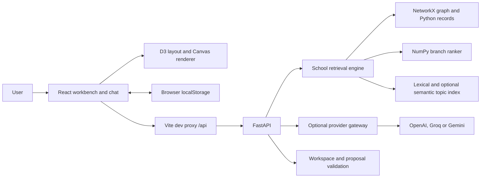
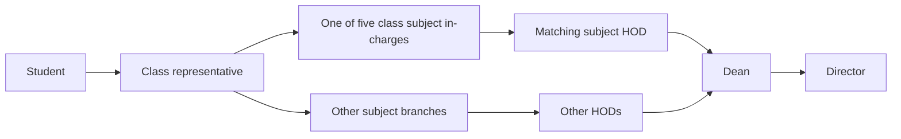
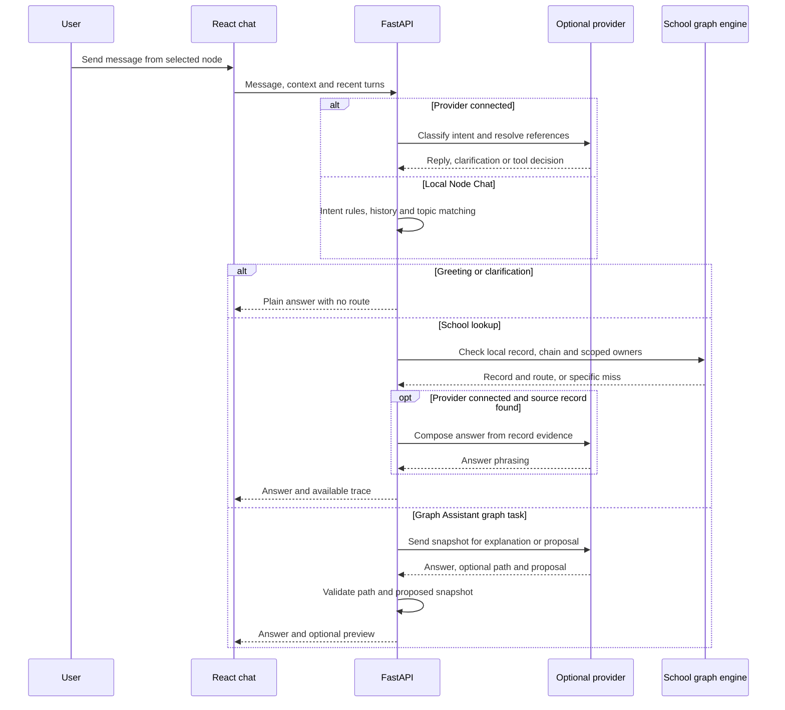

# GNN Brain Technical and Functional Report

**Scope.** This report describes the current working tree, including local changes beyond Git HEAD `ec54eb3`, after removal of unused legacy modules and starter assets. The school data is fictional. Performance observations below are based on code inspection. Potential applications and improvements are explicitly marked.

## 1. Project Overview

GNN Brain is an interactive graph and chat workbench. Its built-in school demonstrates how a question starting at one person can reach the person or office that owns the answer. The app pairs a chat answer with a visual route and, where available, the notice that supplied the answer. A separate example illustrates mean aggregation. A connected AI provider adds contextual conversation, graph explanation, and reviewable graph proposals.

| Need | Current response |
| --- | --- |
| Find the authority for a school question | Start from a selected node and look up a record through the reporting network. |
| Understand why a question reached a particular person | Inspect the owner and replay the computed handoffs. |
| Explore graphs and GNN concepts | Pan, zoom, select nodes, and run the interactive mean-aggregation example. |
| Draft a different organizational graph | Ask a connected provider for a proposal, review it, and save the resulting workspace in the browser. |

The immediate audience is students, instructors demonstrating graphs or GNNs, and developers prototyping hierarchical information retrieval. Potential applications include campus help desks, staff onboarding, departmental policy navigation, and escalation maps. The current application uses demo records and browser-local workspaces. A school-wide deployment would require authoritative data, access control, and shared storage. [App.tsx, lines 102–128 and 200–267](gnn-brain-ui/src/App.tsx#L102-L128) · [brain.py, lines 88–200](gnn-brain-backend/app/graph/brain.py#L88-L200) · [README](README.md)

## 2. System Architecture

| Layer | Technology | Responsibility |
| --- | --- | --- |
| Client | React 19, TypeScript 5.9, CSS, Vite 7 | Workbench, chat threads, provider dialog, local workspace state, HTTP requests. |
| Graph rendering | D3 Force 3 and Canvas 2D | Layout simulation, camera and gestures, drawing, route animation. |
| UI assets | Lucide React, Fontsource Inter and Instrument Sans | Icons and locally bundled typefaces. |
| HTTP service | FastAPI, Uvicorn, Pydantic | API routing, input validation, graph snapshot and proposal validation. |
| Graph and ranking | NetworkX, NumPy | Directed topology, reachability, path construction, supervised branch scoring. |
| Optional text encoding | Sentence Transformers and cached MiniLM | Additional similarity signal for local topic ranking. Optional and undeclared in the required dependencies. |
| Optional AI gateway | Python HTTPS client | Fixed integrations for OpenAI, Groq and Gemini. Users supply a key and model. |

React holds the active graph and conversation state. Vite proxies browser `/api` requests to the backend on port 8000 and strips the prefix. The backend initializes its school engine in memory and attempts optional encoder warm-up on startup. No provider is needed to fetch the demo or use core school retrieval. [Frontend manifest](gnn-brain-ui/package.json) · [Backend requirements](gnn-brain-backend/requirements.txt) · [Vite config](gnn-brain-ui/vite.config.ts#L1-L16) · [main.py, lines 1–42](gnn-brain-backend/app/main.py#L1-L42)



## 3. Graph System

### School construction and topology

The school graph is built from Python constants and generation loops. Classes A–E each have 35 enrolled students, including one class representative (CR). There are five subjects, 25 class-subject in-charges, five department heads, a Dean, and a Director. The backend checks that the school graph is a directed acyclic graph on initialization. Counts below follow from the generation loops and are corroborated by tests. [data.py, lines 5–30 and 59–125](gnn-brain-backend/app/graph/data.py#L5-L30) · [brain.py, lines 49–60](gnn-brain-backend/app/graph/brain.py#L49-L60) · [test_routing.py, lines 63–72](gnn-brain-backend/tests/test_routing.py#L63-L72)

| Role | Nodes | Outgoing relationship | Links |
| --- | ---: | --- | ---: |
| Student | 170 | Own class representative | 170 |
| CR | 5 | Five subject in-charges for that class | 25 |
| In-charge | 25 | Same-subject HOD | 25 |
| HOD | 5 | Dean | 5 |
| Dean | 1 | Director | 1 |
| Director | 1 | None | 0 |
| **Total** | **207** | | **226** |



### Routing and message passing

The backend selects a topic, then checks the starting node and each reporting ancestor on the chosen branch. It takes the only successor where there is one. At the CR's five-way branch, `GNN.choose` scores eligible in-charges. If that chain misses a known topic, the engine searches an undirected view limited to the relevant class and school-wide nodes, and can select a reachable owner by a shortest path. A miss returns the chain that was checked. The return path is the reverse of the answered route when a source record exists. One backend process computes the entire route. Each node is a graph entity with data, rather than a separately executing agent. [brain.py, lines 154–217](gnn-brain-backend/app/graph/brain.py#L154-L217)

The ranker builds a row-normalized staff propagation matrix over self and directly connected subject staff. Question-token matches provide signals from staff text and HOD vocabularies. Propagation averages these signals, including the linked HOD's contribution to the in-charge. The branch scorer uses this propagated signal and a general-question default feature. Two weights are fit with a ridge-regularized least-squares solve using bundled subject examples and general questions, then scores are compared by argmax. This is supervised graph convolution for branch selection, distinct from topic search, route traversal, and LLM generation. The built-in visualization of mean aggregation is a scripted example using values 2, 4 and 6. [gnn_model.py, lines 15–56](gnn-brain-backend/app/graph/gnn_model.py#L15-L56) · [App.tsx, lines 225–228](gnn-brain-ui/src/App.tsx#L225-L228)

### Visualization and replay

School roles and class metadata seed anchors. Generic workspaces use degree-influenced radial positions. D3 applies link, repulsion, collision, centering and anchor forces. Canvas draws links, class and role colors, labels, selection and hover cues. Users can search, select, drag nodes, pan, zoom, fit, and adjust spacing, labels, arrows and motion. The render loop uses animation frames and a resize observer, with reduced-motion handling. The UI turns a response with at least two nodes into a trace. Node Chat supports forward checks, source and return animation. Assistant traces carry a single forward path. The animation is a client-side representation of the returned route. [graphLayout.ts, lines 36–106](gnn-brain-ui/src/graphLayout.ts#L36-L106) · [GraphCanvas.tsx, lines 99–410](gnn-brain-ui/src/GraphCanvas.tsx#L99-L410) · [App.tsx, lines 220–237](gnn-brain-ui/src/App.tsx#L220-L237)

## 4. Database and Knowledge Management

| Data | Storage and ownership | Persistence and access |
| --- | --- | --- |
| School nodes and edges | Python definitions, indexed in a process-local NetworkX graph. | Recreated at startup. Served by `GET /graph`. |
| School records | Owner, topic, aliases, title, answer, reference, optional class/example and local-only flag. The engine indexes by owner and topic. | Bundled source data. Changes require code updates. Institutional notices, class notices and fictional profiles are available according to retrieval scope. |
| Lexical and dense topic data | Topic example sets, vocabulary and optional normalized vectors in memory. | Rebuilt at startup. Encoder weights may already exist in the user's Hugging Face cache. |
| Custom workspaces | React state and per-origin `localStorage`. New/edit proposals are candidate snapshots. | Survive reload in that browser if storage succeeds. School copies and custom edits have no server or cross-device synchronization. |
| Preferences | Browser `localStorage`. | Active workspace, theme and drawer width persist. |
| Chat, selection, traces, drafts and key | React state and refs. | Available during the open session. The main chat uses client-supplied recent history. |
| Compatibility messages | Backend dictionary keyed by node ID with a thread lock. | Cleared by restart and distinct across processes. The current UI uses `/chat` instead. |

There is no active DBMS, ORM, document ingestion pipeline or server-side user repository. Knowledge ownership follows the fictional school structure. Examples include assembly information at the CR, assignments at subject in-charges, workshop information at a HOD, events at the Dean, and ID replacement at the Director. Personal demo profiles are local-only in school retrieval. Scope rules are app logic. [data.py, lines 35–82](gnn-brain-backend/app/graph/data.py#L35-L82) · [knowledge.py, lines 5–158](gnn-brain-backend/app/graph/knowledge.py#L5-L158) · [App.tsx, lines 15–75 and 182–197](gnn-brain-ui/src/App.tsx#L15-L75) · [chat.py, lines 78–101](gnn-brain-backend/app/api/chat.py#L78-L101)

## 5. AI and Conversational System

| Capability | Node Chat | Graph Assistant |
| --- | --- | --- |
| Entry point | `POST /chat`, or local scripted mean-aggregation prompt. | `POST /assistant`, requiring a verified provider connection in the UI. |
| Scope | Selected node. A thread is keyed by workspace and node. | One thread per workspace. The selected node is still supplied as context when it changes. |
| Context | Recent eight turns sent to backend. The most recent turn carrying lookup context can anchor an offline follow-up. Up to four turns go to the provider. | Up to four turns supplied as eight role messages. Planner receives selected node and scope. A later graph action receives the full snapshot. |
| Retrieval | School engine for demo records. Custom graphs return selected node text and immediate neighbor labels. | School lookup invokes the same school engine. Custom graph queries use snapshot reasoning. |
| Sources and paths | Displays a record reference when supplied. Route includes node statuses and can include return path and answer owner. | UI labels the response with the provider name. API returns answer, forward path and optional proposal. |
| Editing | Read/ask flow. | Explains, traces, creates and edits via validated proposals and explicit Apply. |

[App.tsx, lines 107–117 and 204–267](gnn-brain-ui/src/App.tsx#L107-L117) · [chat.py, lines 15–75](gnn-brain-backend/app/api/chat.py#L15-L75) · [assistant.py, lines 216–253](gnn-brain-backend/app/api/assistant.py#L216-L253)

**Provider-backed understanding.** The gateway asks the model for structured JSON choosing `reply`, `clarify`, `lookup` or `graph`. For the school, the first prompt includes the selected node's metadata, direct reporting relationships and a catalog filtered by class and local-only ownership. A lookup can include a standalone query and a validated topic hint. A school record can then be passed to a second provider call for a focused answer. If this wording call fails, the original record text remains available. Full snapshot reasoning is a separate path for graph tasks. The provider can propose a walk, which the backend verifies against actual links, and changes, which the backend validates against workspace rules. [assistant.py, lines 64–129 and 216–253](gnn-brain-backend/app/api/assistant.py#L64-L129) · [workspace.py, lines 60–113](gnn-brain-backend/app/graph/workspace.py#L60-L113)

**Without a provider.** Lightweight rules recognize greetings, acknowledgements, identity requests, common follow-up forms and some vague requests. Topic matching first checks normalized aliases. When permitted, the local ranker uses sample paraphrases, fuzzy correction and token overlap, augmented by optional cached embeddings. Ambiguous matches can yield a focused clarification. For a real but unanswered institutional request, the backend names the request and the endpoints checked. In an explicitly provider-planned institutional lookup, the engine expects a validated topic hint or matching alias. It skips its fuzzy ranking branch. Offline contextual answers often repeat the full notice. [conversation.py, lines 27–70](gnn-brain-backend/app/graph/conversation.py#L27-L70) · [semantic.py, lines 37–94](gnn-brain-backend/app/graph/semantic.py#L37-L94) · [brain.py, lines 88–200](gnn-brain-backend/app/graph/brain.py#L88-L200)

## 6. Complete Working Mechanism

### Opening the application and choosing a node

1. The entry point mounts React. App loads the saved workspace list, active workspace, theme and drawer width. It fetches the school graph using `/api/graph`. A failed fetch exposes a retry.
2. The backend returns graph data, classes, subjects, scenario prompts and the default node ID `S-A-1`. App chooses the built-in school, the scripted example, or a locally saved workspace.
3. Canvas derives drawable positions and initializes the camera. Selecting from the graph or search updates the workspace's selected ID, opens chat, clears the search and resets explicit replay. In Node Chat, this also selects the node-specific thread. [main.tsx](gnn-brain-ui/src/main.tsx) · [App.tsx, lines 83–116 and 155–164](gnn-brain-ui/src/App.tsx#L83-L116) · [brain.py, lines 71–82](gnn-brain-backend/app/graph/brain.py#L71-L82)

### Sending a greeting, asking a question, or following up

1. App guards against a duplicate in-flight request per thread and sends the message with optional provider settings and bounded history.
2. A greeting handled by the local classifier or provider planner returns a conversational reply without a trace.
3. A question such as “When is Founders Day?” resolves to a demo topic. Starting from a student, the engine checks the student, CR, chosen subject in-charge, HOD and Dean. The Dean's bulletin supplies the answer. Node Chat attaches the reference, forward route and reverse return path.
4. “And where is it?” can reuse the last retained school topic, even after an acknowledgement. Offline, the engine uses its supported follow-up pattern and prior lookup context. With a provider, the model can expand the question using history and produce venue-specific wording from the same evidence.
5. If the selected node lacks the record, the engine escalates and may consult a reachable owner in scope. If the search fails, it reports the missing topic or request. A vague event question may instead prompt the user to identify the event. A request explicitly outside the selected class can receive a class-scope clarification. [App.tsx, lines 204–245](gnn-brain-ui/src/App.tsx#L204-L245) · [chat.py, lines 48–75](gnn-brain-backend/app/api/chat.py#L48-L75) · [brain.py, lines 107–200](gnn-brain-backend/app/graph/brain.py#L107-L200)



### Replaying and switching modes

1. **Replay.** The button uses the stored trace and sets a new trace ID. Canvas restarts its clock and draws each segment using 380 ms step timing. Forward and return phases update the graph status where present. Replay does not call the backend.
2. **Mode switch.** The mode control changes the thread key and the appropriate compose/connection state. Node Chat threads remain associated with the workspace and selected node. Graph Assistant keeps one workspace-wide thread. Reconnecting a provider opens Graph Assistant. Switching modes does not transfer the other mode's turn history. [App.tsx, lines 107–115 and 366–377](gnn-brain-ui/src/App.tsx#L366-L377) · [ChatModeSwitch.tsx](gnn-brain-ui/src/ChatModeSwitch.tsx) · [GraphCanvas.tsx, lines 20–22 and 141–165](gnn-brain-ui/src/GraphCanvas.tsx#L141-L165)

## 7. Features and Capabilities

| Status | Capabilities |
| --- | --- |
| Implemented · Workbench | Dark and light themes, searchable canvas, zoom/pan/fit, node dragging and selection, display settings, responsive collapsible chat drawer, pointer and keyboard resizing, per-thread drafts, prompts, question library, retries and chat replay. |
| Implemented · School | Five-class fictional hierarchy, role-specific records, reporting context, graph-convolution branch scoring, scoped retrieval, record references, unavailable notices and outward/return traces. |
| Implemented · Provider | Connection check and BYO key, contextual planning, plain conversation and clarifications, grounded record phrasing, snapshot explanation, path validation, and human-reviewed editing or generation. |
| Implemented · Education | A standalone scripted demonstration of mean aggregation, including animated contributing neighbors. |
| Implemented · Workspace management | Blank workspace creation, switching among built-in and local workspaces, provider-proposed title/node/link changes, preview and apply. Built-in graphs are copied when edited. |
| Partial · Conversation | Recent session history, limited offline intent and follow-ups, provider-dependent free-form reasoning. |
| Partial · Custom graphs | Snapshot explanation and immediate-neighbor Node Chat. The school-specific record ownership, ranker and escalation pipeline do not generalize automatically to custom graphs. |
| Potential | Shared institutional deployment, access-controlled records, ingestion and versioning, durable memory, automated workflow routing. |

The distinctive behavior is the combination of visible retrieval provenance with a separate educational GNN example and a reviewable graph authoring workflow. [ChatPanel.tsx, lines 53–202](gnn-brain-ui/src/ChatPanel.tsx#L53-L202) · [App.tsx, lines 182–267](gnn-brain-ui/src/App.tsx#L182-L267) · [GraphCanvas.tsx, lines 415–551](gnn-brain-ui/src/GraphCanvas.tsx#L415-L551)

## 8. Codebase Structure

```text
GNN brain/
  README.md
  GNN_BRAIN_PROJECT_REPORT.md
  gnn-brain-backend/
    requirements.txt
    app/main.py
    app/api/{chat,assistant}.py
    app/graph/{brain,data,knowledge,semantic,conversation,gnn_model,workspace}.py
    tests/{test_routing,test_assistant}.py
  gnn-brain-ui/
    package.json, package-lock.json, vite.config.ts
    index.html, tsconfig*.json, eslint.config.js
    src/{main,App,ChatPanel,GraphCanvas,ChatModeSwitch,ProviderDialog,Icon}.tsx
    src/{api,school,graphLayout}.ts
    src/{index,App,ChatPanel}.css
```

| Main file | Responsibility and entry points |
| --- | --- |
| [main.py](gnn-brain-backend/app/main.py#L13-L45) | Startup lifecycle, CORS, router registration, graph and shortest path endpoints. |
| [chat.py](gnn-brain-backend/app/api/chat.py#L30-L101) | `chat_endpoint`, `custom_chat`, prior-turn handling, and compatibility store. |
| [assistant.py](gnn-brain-backend/app/api/assistant.py#L71-L129) | `plan_conversation`, `school_answer`, provider transport and assistant orchestration. |
| [brain.py](gnn-brain-backend/app/graph/brain.py#L49-L217) | `ChatbotEngine`, node resolution and context, pursuit of a source record, response metadata. |
| [data.py](gnn-brain-backend/app/graph/data.py) and [knowledge.py](gnn-brain-backend/app/graph/knowledge.py#L128-L158) | Topology, initial records, generated profiles and scenario library. |
| [gnn_model.py](gnn-brain-backend/app/graph/gnn_model.py#L15-L56), [semantic.py](gnn-brain-backend/app/graph/semantic.py#L37-L94), [conversation.py](gnn-brain-backend/app/graph/conversation.py#L27-L70) | Branch scoring, topic ranking, and offline conversational rules respectively. |
| [workspace.py](gnn-brain-backend/app/graph/workspace.py#L33-L113) | Strict snapshot schema, `apply_changes` and `checked_path`. |
| [App.tsx](gnn-brain-ui/src/App.tsx#L47-L82) | React state for workspace, selection, provider, threads, resize, traces and requests. |
| [GraphCanvas.tsx](gnn-brain-ui/src/GraphCanvas.tsx#L74-L105) and [graphLayout.ts](gnn-brain-ui/src/graphLayout.ts#L36-L106) | Camera, rendering, hit testing, interaction, simulation and anchors. |
| [ChatPanel.tsx](gnn-brain-ui/src/ChatPanel.tsx#L112-L202), [ProviderDialog.tsx](gnn-brain-ui/src/ProviderDialog.tsx#L15-L45), [api.ts](gnn-brain-ui/src/api.ts#L1-L15) | Conversation UI, connection setup and typed HTTP wrapper. |

### HTTP endpoints

The backend paths below do not include the browser's development `/api` proxy prefix.

| Endpoint | Request and response |
| --- | --- |
| `GET /` | Service status message. |
| `GET /graph` | School snapshot including nodes, links, classes, subjects, scenarios and default node. |
| `GET /path/{node_id}` | Directed shortest path to Director. Unknown identifiers produce 404. Independent of chat routing and replay. |
| `POST /chat` | Query, optional node, context/history, custom workspace and provider config. Returns answer, status, context, sources, route, return path and optional record metadata. |
| `POST /assistant/connection` | Provider/model plus `X-Provider-Key`. Tests JSON response with a small request. |
| `POST /assistant` | Query, selected ID, history, optional workspace and provider settings/key. Returns answer, path and optional proposal. |
| `GET /messages?nodeId=…`, `POST /messages` | Reads or appends compatibility messages in process memory. POST returns the generated bot message. |

Settings are largely in code. Vite points to `127.0.0.1:8000` and CORS allows the two localhost port-5173 origins. The app reads provider/model from the dialog and sends the key in a header. There is no app-specific environment-variable loader in the active code. Current source defaults are `gpt-5-mini`, `openai/gpt-oss-20b` and `gemini-3.5-flash-lite`. These are configured strings, independent of live account availability. Browser persistence keys are versioned with `.v1`. [main.py, lines 18–42](gnn-brain-backend/app/main.py#L18-L42) · [api.ts, lines 1–15](gnn-brain-ui/src/api.ts#L1-L15) · [App.tsx, lines 15–44](gnn-brain-ui/src/App.tsx#L15-L44)

## 9. Performance and Scalability

| Area | Code-derived cost and implications |
| --- | --- |
| Exact topic and record retrieval | Alias checks scan bundled aliases. At a visited node, owner/topic dictionary lookup is expected constant time. Chain work grows with hop count and branch scoring. |
| Authority fallback | Unweighted shortest-path exploration scans the accessible induced view, with traversal time proportional to its vertices and edges plus a record scan. Storing a full path list for each reached vertex can add a sum-of-path-lengths cost. |
| Branch ranking | Dense staff matrix multiplication costs O(S²) per scoring call for S subject-staff nodes. Initialization fits a small model from bundled examples. Current data has 30 subject-staff nodes and five CR choices. |
| Topic ranking | Unknown eligible tokens scan the vocabulary for fuzzy similarity. Then ranking scans the example set. Optional query encoding adds model inference and a dot-product scan over cached vectors. |
| Canvas and layout | A paint pass visits nodes and links, with additional passes for visible traces and labels. Hit testing scans nodes. Layout performs 160 initial ticks, each including link and spatial forces. Larger or visually dense graphs increase layout and paint work. |
| Provider round trips | A complex turn can require two sequential network calls. Backend socket timeout is 40 seconds per connection. Browser chat deadlines are 85 seconds with a provider and 15 seconds without one. Full snapshot prompting also grows with graph and text size. |

The current custom snapshot validator caps graphs at 350 nodes and 1,400 links. The implementation supplies no load test, capacity benchmark or measured latency target. Larger deployments would encounter prompt size and provider latency, full-graph Canvas work, dense branch propagation if extended to many staff, and memory/storage ceilings. [brain.py, lines 39–46 and 175–197](gnn-brain-backend/app/graph/brain.py#L175-L197) · [gnn_model.py, lines 16–56](gnn-brain-backend/app/graph/gnn_model.py#L16-L56) · [semantic.py, lines 70–94](gnn-brain-backend/app/graph/semantic.py#L70-L94) · [graphLayout.ts, lines 75–106](gnn-brain-ui/src/graphLayout.ts#L75-L106) · [workspace.py, lines 33–49](gnn-brain-backend/app/graph/workspace.py#L33-L49)

## 10. Security and Reliability

- **Credentials and external data.** Provider keys live in tab memory and travel to the local backend in `X-Provider-Key`, then to one of three fixed HTTPS hosts. OpenAI requests specify `store: false`. Provider-backed turns may send selected metadata, catalog examples, recent chat or retrieved evidence. Snapshot requests can send custom graph nodes, edges and text, or school demo records and the selected demo profile. The code does not establish provider-side retention guarantees. [api.ts, lines 1–10](gnn-brain-ui/src/api.ts#L1-L10) · [assistant.py, lines 71–129, 164–202 and 234–247](gnn-brain-backend/app/api/assistant.py#L164-L202)
- **Access control.** The code uses local-development CORS and data-scope rules. There are no authenticated product accounts, role-based permissions, or tenant isolation. Model keys authorize use of the external model. The compatibility message endpoints allow access by node ID and share their in-memory state within a worker. [main.py, lines 18–27](gnn-brain-backend/app/main.py#L18-L27) · [chat.py, lines 78–101](gnn-brain-backend/app/api/chat.py#L78-L101)
- **Validation.** Schemas restrict lengths, IDs, fields and supported providers. Graph validation rejects duplicate IDs and directed pairs, unknown endpoints, and self-links. Proposal validation rejects contradictory operations and invalid removes, strips incident links on node removal, and requires a changed nonempty result. Walks reject repeats and disconnected hops, using either direction of actual edges. The UI compares a proposal's base snapshot before applying it and keeps built-in sources separate from their edited copies. [workspace.py, lines 7–113](gnn-brain-backend/app/graph/workspace.py#L7-L113) · [App.tsx, lines 248–267](gnn-brain-ui/src/App.tsx#L248-L267)
- **Provider response validation.** Gemini requests schemas for connection checks, conversation plans and evidence rephrasing. Plans allow null or omitted text fields when unused. Replies and clarifications require nonblank answers. A failed evidence rephrase retains the original record answer. Truncated Gemini responses produce a specific error, and the API reports malformed graph replies separately from proposals that fail graph integrity checks. [Assistant gateway](gnn-brain-backend/app/api/assistant.py)
- **Failure handling.** Provider failures produce controlled HTTP errors for keys, quotas, models, response formats or availability. The app displays request errors and warns if a custom graph could not be saved to browser storage. [Assistant gateway](gnn-brain-backend/app/api/assistant.py) · [Workspace and chat UI](gnn-brain-ui/src/App.tsx)
- **Verification.** The backend suite covers hierarchy, class scoping, conversational cases, mocked provider calls, key handling and invalid graph operations. Frontend checks include ESLint, TypeScript and the Vite production build. Live provider accounts and production capacity require separate verification. [Routing tests](gnn-brain-backend/tests/test_routing.py) · [Assistant tests](gnn-brain-backend/tests/test_assistant.py)

## 11. Current Limitations

| Limitation | Consequence |
| --- | --- |
| Fictional, code-defined corpus | No ingestion, freshness tracking, record versioning, campus integration or editor for authoritative notices. |
| Thin memory model | History resets on refresh in the product UI. Long-running conversations can lose details beyond four provider-visible turns. |
| Offline intent depends on rules and curated examples | Paraphrase and misspelling coverage varies, especially without cached MiniLM. Stable topic references work better than broad or multi-intent context. Event overview uses a fixed subset of topics. |
| Provider planner uses a bounded catalog and a separate second call | Invalid/missed topic hints can reduce retrieval recall because the institutional branch bypasses fuzzy ranking. General model answers and graph explanations may contain unsupported claims despite grounding instructions. |
| Trace is a selected explanation path | Shortest-path authority fallback can traverse links opposite their reporting direction. Assistant path validation checks topology rather than provenance or direction. Multi-record event replies carry no single authoritative path. |
| Custom workspaces are snapshots | Graphs may contain cycles. Node Chat sees immediate neighbors and descriptive text, with no general record retrieval or trained routing on those graphs. Local storage and in-memory proposal context limit collaboration. |
| Prototype operations and privacy | No application authentication, audit history, quotas, durable storage, automated end-to-end browser suite or deployment configuration in the project source. Full graph data may leave the browser when using an external provider. |

[brain.py, lines 107–200](gnn-brain-backend/app/graph/brain.py#L107-L200) · [chat.py, lines 30–73](gnn-brain-backend/app/api/chat.py#L30-L73) · [assistant.py, lines 216–253](gnn-brain-backend/app/api/assistant.py#L216-L253) · [workspace.py, lines 33–49 and 106–113](gnn-brain-backend/app/graph/workspace.py#L106-L113)

## 12. Future Potential

The items below are development opportunities.

| Opportunity | Possible implementation | Intended value |
| --- | --- | --- |
| Institutional knowledge | Versioned records and ingestion from approved policies, calendars and directories. Add effective dates, stable citations and access scopes. | Answers can use current, attributable information. |
| Better retrieval and conversation | Typed tools for search, record fetch, linked entities and routing. Add semantic candidate retrieval when model hints are absent, structured conversation state and evaluation sets. | More reliable paraphrases, clarification and follow-up behavior. |
| Graph learning and pedagogy | Evaluate branch routing against baselines, add held-out examples, and expose inspectable aggregation and scoring. | Separates the educational demonstration from measured model quality. |
| Shared graph workspaces | Durable storage, authenticated users and tenants, revisions, concurrent editing and activity logs. | Team-managed graphs and reviewable knowledge maintenance. |
| Data and provider governance | Configure provider policy, scope graph payloads, add retention controls, monitoring and request budgets. | Supports institutional risk and cost management. |
| Scale and commercialization | Add performance tests, spatial hit testing and viewport culling at scale. Pilot school help desks, onboarding or internal escalation before broader rollout. | Validates useful workflows and operational feasibility before commercial commitments. |

## 13. Final Project Summary

GNN Brain is a functional educational and institutional-question prototype. The school demo combines a 207-node hierarchy, role-owned records, a supervised graph-convolution branch ranker and source-aware chat. The browser turns completed retrieval into a replayable graph trace. A connected model adds contextual planning, source-backed wording and reviewable graph proposals. The same interface also provides a scripted mean-aggregation example and local custom workspaces.

The project is ready for demonstrations and further product development. Its strongest implemented distinction is visible information routing, grounded in owners and graph links. Shared, privacy-sensitive institutional use would require real-data governance, authentication, persistence, evaluation and operational hardening.
