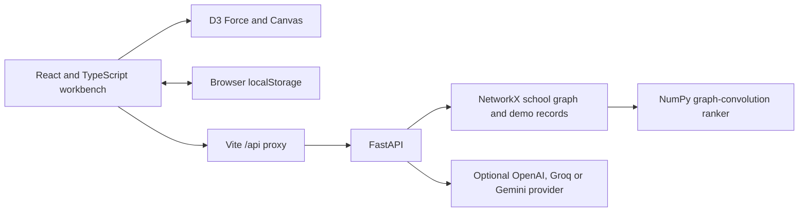

# GNN Brain — An AI-Powered Graph Intelligence and Explainable Knowledge Routing Platform

**Ask a school question and watch it travel through the network.** GNN Brain combines an interactive graph, source-backed node chat, and a small graph-convolution model that routes subject questions.

The fictional school has **207 nodes**, **226 links**, and **34 searchable example questions**. Five classes of 35 students are connected through class representatives, subject in-charges, department heads, the Dean, and the Director.

## Project objectives

- Make knowledge ownership and escalation visible.
- Show how graph convolution can help choose a routing branch.
- Let users explore, explain, and draft graph structures in the same workspace.

## Key features

- Interactive Canvas graph with node search, zoom, pan, dragging, and adjustable labels, arrows and motion.
- Source-backed school chat with animated outward and return routes and replay.
- Resizable, collapsible chat panel, separate mode histories, and light and dark themes.
- Optional Graph Assistant for contextual conversation, graph explanations, and validated graph proposals.
- Browser-local custom workspaces and a standalone mean-aggregation example.

## System architecture



The frontend uses React, TypeScript, Vite, D3 Force and Canvas 2D. The backend uses FastAPI, Pydantic, NetworkX and NumPy. Read the [technical report](GNN_BRAIN_PROJECT_REPORT.md) for the API, data structures and request workflows.

## Quick start

Requires Python 3.10+ and Node.js 20.19+ on the 20.x line, or 22.12+. Clone the public repository:

```sh
git clone https://github.com/bsaiteja0714/GNN-brain.git
cd GNN-brain
```

Start the FastAPI backend on **port 8000**.

<details open>
<summary>Windows PowerShell</summary>

```powershell
python -m venv .venv
.\.venv\Scripts\python.exe -m pip install -r gnn-brain-backend\requirements.txt
Set-Location gnn-brain-backend
..\.venv\Scripts\python.exe -m uvicorn app.main:app --reload --host 127.0.0.1 --port 8000
```

</details>

<details>
<summary>macOS or Linux</summary>

```sh
python3 -m venv .venv
.venv/bin/python -m pip install -r gnn-brain-backend/requirements.txt
cd gnn-brain-backend
../.venv/bin/python -m uvicorn app.main:app --reload --host 127.0.0.1 --port 8000
```

</details>

In a second terminal, from the repository root, start the React frontend:

```sh
cd gnn-brain-ui
npm ci
npm run dev -- --host 127.0.0.1
```

Open [the app](http://127.0.0.1:5173/) or [the API docs](http://127.0.0.1:8000/docs). Node chat and the message-passing example work without a provider key.

## Try the school graph

Select a student and ask **“When is Founders Day?”** The question travels through the class representative, an in-charge, and a department head to the Dean. The reply appears in chat while the graph animates its return. Use **Replay path** to revisit the route.

| Try asking | Source |
| --- | --- |
| What are you working on? | Selected student or class representative |
| Where is our morning assembly? | Class representative |
| When is the maths assignment due? | Maths in-charge |
| When is the coding workshop? | Computing HOD |
| How do I borrow or renew a library book? | Dean |
| What should I do if I lost my student ID? | Director |

Use **Question library** to browse more examples. Search for a node by name or role, drag nodes to explore connections, and use **Fit graph** to reset the view. The graph menu also includes a standalone mean-aggregation example.

## GNN-assisted routing

Each node checks its own records before passing the question onward. At a class representative’s subject branch, the model aggregates neighboring HOD signals and ranks the available in-charges. General school questions start on the Science branch. If a relevant published record is reachable outside the upward chain, the app can consult its owner within the class or school-wide scope. Answers cite their demo record, and unrecognized questions return an unresolved result.

The frontend uses React, TypeScript, Vite, and a D3 force layout rendered on Canvas. The backend uses FastAPI, NetworkX, and NumPy. The [school graph](gnn-brain-backend/app/graph/data.py), [knowledge records](gnn-brain-backend/app/graph/knowledge.py), and [routing model](gnn-brain-backend/app/graph/gnn_model.py) are separate so they can be inspected independently.

The routing model performs one graph-convolution step over subject staff. It averages token-match signals from an in-charge and their connected HOD, then ranks the candidate branches using two weights fitted by ridge-regularized least squares on bundled examples. The resulting branch score guides traversal. The school engine retrieves the actual answer from a record owned by a reachable node.

## Node Chat and Graph Assistant

**Node Chat** starts from the selected node and keeps a separate thread for that node. It works without an API key. When a provider is connected, the model can interpret follow-ups and phrase answers from retrieved evidence. Casual replies can skip graph traversal.

**Graph Assistant** keeps a workspace-wide thread. It uses a connected provider to answer questions about the graph, illustrate relationships, or propose new graphs and edits. Review a validated proposal and choose **Apply** to save it locally. Editors work on a copy when starting from a built-in graph.

### Connect an AI provider

Open the plug icon and choose **OpenAI**, **Groq**, or **Google AI Studio (Gemini)**. Enter your API key and a model that supports JSON output. The assistant can explain the active graph, show a valid example path, or propose a graph edit for you to review and apply. Custom graphs are saved in the browser.

Select the provider, enter a model ID that supports JSON output and paste your key. Choose **Connect** to run a short verification request. Provider-backed chat can send your message, recent history, node context and retrieved evidence. Graph Assistant can also send the active graph snapshot and the relevant demo data. The key is held in tab memory and sent through the local backend to the selected provider. [Get a Gemini API key](https://aistudio.google.com/api-keys)

## Checks

```sh
# From gnn-brain-backend, with the virtual environment active
python -m unittest discover -s tests

# From gnn-brain-ui
npm run lint
npm exec -- tsc -b
npm run build
```

## Current limitations

- School data is fictional and bundled with the application. There is no shared graph database or document ingestion.
- Custom graphs support immediate-neighbor Node Chat and provider-assisted snapshot reasoning. The school routing engine is specific to the demo hierarchy.
- Chat history is session-local. Custom graphs and selected preferences persist in the browser.
- The demo has no product accounts or role-based access control. Use fictional or otherwise appropriate data with external providers.

## Roadmap

The following are future development areas.

- Persistent graph database and shared workspaces.
- Advanced GNN architecture and evaluation against routing baselines.
- Generalized knowledge routing for custom graphs.
- Document ingestion and knowledge management.
- Improved semantic retrieval and source ranking.
- Persistent conversational memory.
- Authentication and role-based access control.
- Scalability and performance optimization.

## Demo data

School names, schedules, policies, and student profiles are fictional. Scenario ideas came from published guidance on library use, missed assessments, trips, and exams. [Bradford High School](https://www.kusd.edu/bradford/information/practices-procedures/) · [Pottsgrove School District](https://www.pgsd.org/resources/parent-resources/pgms-student-handbook) · [Rankin County School District](https://www.rcsd.ms/parents/student-handbook) · [CBSE](https://www.cbse.gov.in/cbsenew/Examination_Circular.html)
